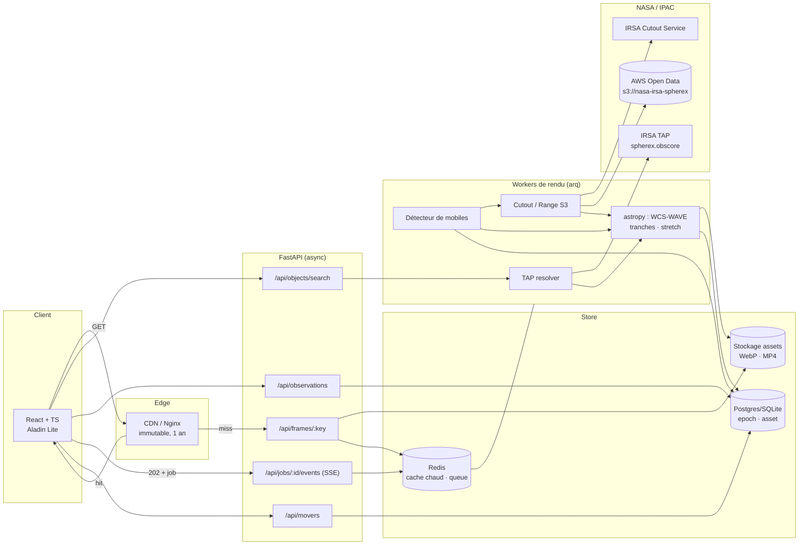
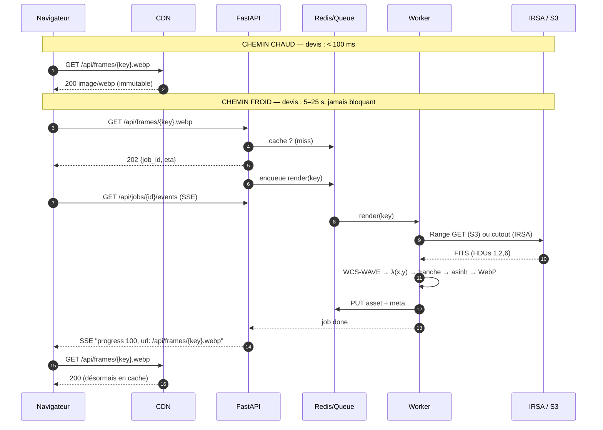

# SkyTrace — Blueprint produit et architecture (v2)

**Challenge** : NASA Space Apps 2026 · *Planet X and SPHEREx* · hackathon 14–15 novembre 2026
**Ce document** : corrige l'architecture proposée par l'équipe, intègre les données vérifiées le 13/11/2026, et définit le produit.
**Compagnon** : `ARCHITECTURE.md` (audit des données et chiffres mesurés du 10/11) et `sky-trace-architecture.html`.

---

## 0. Verdict sur l'architecture proposée

> USER → React → FastAPI → IRSA → astropy → React

**Comme modèle mental : juste.** Quatre couches, la bonne séparation, les bons outils.
**Comme chemin d'exécution : cassé.** Trois défauts, chacun fatal en démo publique.

| # | Défaut | Preuve mesurée | Conséquence publique |
|---|---|---|---|
| 1 | **IRSA et astropy sont dans le cycle requête/réponse** | cutout 0,05° = **5,07 Mo / 21,4 s** ; cutout 0,3° = **échec à 420 s** | 30 visiteurs simultanés = 30 connexions IRSA, file d'attente de plusieurs minutes, l'un d'eux voit une erreur |
| 2 | **`astropy` bloquant dans un handler `async`** | lecture + découpe + stretch = 1–3 s CPU ; Python n'a qu'un thread par worker | chaque requête immobilise un worker entier : le serveur s'effondre à ~6 utilisateurs, pas 600 |
| 3 | **Aucune hiérarchie de temps** | 6,45 min / 8,03 h / 6,1 mois sont trois axes distincts | l'utilisateur reçoit « des images », pas « comment ça change » |

### Les 3 corrections (chirurgicales, pas une réécriture)

**Correction 1 — sortir la donnée du chemin chaud.**

```
❌  React ──► FastAPI ──► IRSA (21 s) ──► astropy ──► React
✅  React ──► CDN (60 ms) ──► WebP
                  │ miss
                  └──► FastAPI ──► Redis/S3 ──► 202 + job_id ──► [Worker: IRSA→astropy→WebP] ──► SSE
```

L'utilisateur n'attend jamais IRSA. Au pire il attend un job court, avec une progression réelle.

**Correction 2 — `astropy` dans un worker, jamais dans le handler.**
`run_in_executor` sur un pool dédié, ou mieux : un service `render` séparé (arq/Celery). Le handler HTTP ne fait que lire un cache et, s'il est vide, enfiler. C'est la différence entre 6 et 600 utilisateurs.

**Correction 3 — la timeline est une donnée, pas un tableau de vignettes.**
`GET /api/observations` doit renvoyer les époques **groupées par axe** (intra-slew / nuit / époque), et le frontend doit proposer le bon axe par défaut selon la couverture réelle du champ. Détail §3.3.

### Deux corrections de fond, sur le brief lui-même

**A. « Prioriser QR3, QR2 en fallback » est faux depuis le 12 novembre.**

DR1 est sorti **hier**. Ce que l'archive contient réellement ce soir (compté par TAP, `GROUP BY obs_collection`) :

| Collection | Images | Couverture temporelle (MJD) | Rôle |
|---|---|---|---|
| `spherex_dr1` | 945 725 | 60789,8 → 61174,5 | **la base** : QR2 retraité, calibration v27 |
| `spherex_dr1_deep` | 233 681 | 60789,8 → 61174,5 | champs profonds, même époque |
| `spherex_qr3` | 362 124 | 61174,5 → 61318,0 | **la suite** : données récentes |
| `spherex_qr3_deep` | 86 700 | 61174,5 → 61318,0 | champs profonds, récents |
| `spherex_dr1_cal` | 88 | — | calibration |

Deux faits qui décident de l'architecture :

1. **DR1 et QR3 ne se remplacent pas, ils se complètent dans le temps.** La frontière est nette : DR1 s'arrête à MJD 61174, QR3 commence à MJD 61174. Un outil qui n'utilise que QR3 ne montre **qu'une seule époque** pour la majorité du ciel — donc aucune vidéo. C'est le piège n°1 du hackathon.
2. **`spherex_qr2` n'existe plus** dans `obscore` : il a été remplacé par DR1. Tous les tutoriels et notebooks qui écrivent `COLLECTION=spherex_qr2` sont périmés ce soir. **À vérifier avant la démo** : c'est un avantage compétitif si l'équipe le sait et pas les autres.

Règle d'implémentation, à mettre dans une constante unique du backend :

```python
COLLECTIONS = ("spherex_dr1", "spherex_dr1_deep", "spherex_qr3", "spherex_qr3_deep")
SOURCE_PRIORITY = ("dr1", "qr3")   # complémentaires, jamais l'un sans l'autre
# réponse attendue : union, dédoublonnée par (mjd, detector, band), triée par temps
```

**B. « Les 102 bandes » ne veut pas dire ce qu'on croit — et DR1 apporte un cube all-sky.**

- Les 6 détecteurs × 17 canaux = les 102 bandes **nominales** de la mission.
- Mais l'axe spectral est **continu** dans chaque image (filtre à épaisseur variable), décrit par `WCS-WAVE`. Le cube PSF fourni a **121 plans spectraux** : l'axe est sur-échantillonné.
- **DR1 contient en plus un cube spectral all-sky à 102 canaux** (`dr1/hips5_cube/hips_20261026/Norder5/`). Vérifié : **chaque tuile pèse 306 Mo** (≈ 512×512 px × 102 canaux × 3 extensions). Soit ~1,8° de ciel et 12,7″/px par tuile.

  → **Ne pas essayer de servir ce cube au navigateur.** 306 Mo par tuile, c'est 4 ordres de grandeur au-dessus de ce qu'Aladin Lite attend. Il est fait pour l'analyse hors ligne.
  → **Ce qu'il vaut quand même** : si l'équipe a du temps, une découpe serveur par requêtes `Range` (fenêtre 32×32 × 102 canaux = 418 Ko) donne des spectres all-sky instantanés. À classer *nice-to-have*, pas MVP.

### Ce que le brief demande et qui est à jeter

| Demande du brief | Problème | Décision |
|---|---|---|
| 7 sections (Home, Explore, Time Travel, Spectral Lab, Discoveries, Meet SPHEREx, Resources) | 7 pages = 5 coquilles vides en 48 h | **4 destinations** (§3.1) |
| « Prioriser QR3, QR2 en fallback » | obsolète depuis le 12/11 | DR1 + QR3, union obligatoire |
| « PostgreSQL, SQLite, ou pas de base ? » | question mal posée | Postgres **si** on indexe les époques ; SQLite suffit pour le MVP mono-machine (§5) |
| « Détecter les objets qui bougent » | risque de surclaim scientifique | §8 : vocabulaire et garde-fous imposés |

---

## 1. Produit

### 1.1 Ce qu'est SkyTrace

**SkyTrace est un télescope temporel.** On lui donne une parcelle de ciel, il rend le film : ce que SPHEREx a vu de cette parcelle, quand, à quelle longueur d'onde, et ce qui a bougé.

Pas un explorateur de catalogue. Pas une visionneuse FITS. Un outil qui répond à *« qu'est-ce qui a changé ici ? »* en moins de dix secondes.

### 1.2 Le problème résolu

SPHEREx produit 1 628 318 images (compté ce soir) représentant plus d'un milliard d'objets. Aucun humain ne peut s'y orienter. Les outils existants (SPHEREx Data Explorer d'IRSA, Aladin) sont faits par des astronomes **pour** des astronomes : ils demandent de connaître les collections, les versions de calibration, les extensions FITS.

SkyTrace prend la question du public — *« montre-moi cet endroit du ciel »* — et la traduit en requêtes TAP correctes, avec un rendu lisible et une provenance affichée.

### 1.3 Utilisateurs et ce qu'ils viennent chercher

| Persona | Ce qu'il tape | Ce qu'il doit obtenir en < 10 s | Ce qui le fait revenir |
|---|---|---|---|
| **Curieux (70 %)** | « WISE 0855 » (bouton) | une image, un bouton *Play*, un point qui bouge | la sensation de voir l'invisible |
| **Amateur équipé (20 %)** | RA/Dec d'un champ | les époques disponibles, le blink, les flags | la précision et les métadonnées |
| **Étudiant / enseignant (8 %)** | une cible de cours | le spectre, l'explication de la longueur d'onde | la fiche pédagogique |
| **Astronome (2 %)** | un candidat | le lien vers les FITS bruts et la méthode | la reproductibilité |

**Conséquence de design** : le premier écran doit fonctionner **sans saisie**. Un juge qui ouvre l'outil et voit un champ vide avec deux inputs RA/Dec referme l'onglet. Un juge qui voit une image du ciel avec un bouton *Play* reste.

### 1.4 Ce qui différencie SkyTrace

| Outil existant | Ce qu'il fait | Ce que SkyTrace fait en plus |
|---|---|---|
| SPHEREx Data Explorer (IRSA) | recherche et téléchargement pour experts | rendu immédiat, langage public, timeline |
| Aladin Desktop | visualisation professionnelle | zéro installation, sélection des époques, différence en 1 clic |
| WorldWide Telescope | ciel optique, narration | SPHEREx infrarouge + axe spectral + candidats mobiles |
| backyardworlds.org | science citoyenne sur WISE | pipeline automatisé de candidats + validation communautaire |

La différence n'est pas une fonctionnalité isolée : c'est **le passage de « télécharger des données » à « regarder un phénomène »**, sans sacrifier la traçabilité scientifique.

### 1.5 MVP vs avancé

**MVP (à finir, non négociable)** — 12 points, détail §9 :

1. Résolution d'un nom d'objet → coordonnées (5 cibles en dur + SIMBAD si le temps)
2. Saisie RA/Dec + validation
3. `GET /api/observations` : union DR1 + QR3, triée, avec trous signalés
4. Une image rendue par époque (serveur, WebP, stretch asinh)
5. Timeline multi-axes avec épilogue par défaut correct
6. Blink entre deux époques
7. Panneau métadonnées (OBSID, date, détecteur, calibration, flags)
8. Différence en 2 modes (brut, normalisé par la variance)
9. Vue 102 bandes (tranches λ) avec spectre au clic
10. Deep-link URL complet
11. Mode démo hors ligne (5 champs précalculés)
12. Provenance + attribution NASA visibles

**Avancé (seulement si le MVP est fini)** :

- Détection automatique de mobiles + score (§8)
- Validation communautaire (valider/rejeter) et page *Discoveries*
- Overlays Gaia/WISE via HiPS
- Export MP4 / GIF
- Cube spectral all-sky DR1 via Range S3
- Mosaïque multi-détecteurs (champ > 3,5°)

**À ne pas faire** : comptes utilisateurs, base de données de profils, notifications, mobile app native, i18n. Aucun juge ne les regarde.

---

## 2. Ce qui gagne à Space Apps (et ce qui ne gagne pas)

Cinq critères, notés 1–5 : Impact, Créativité, Validité, Pertinence, Présentation.

| Critère | Ce qui rapporte des points ici | Ce qui en coûte |
|---|---|---|
| Impact | fonctionne sur un téléphone, sans compte, en 10 s ; mode éducatif | jargon, login, écran vide |
| Créativité | les 4 axes de temps ; différence en 3 modes ; spectre au clic ; plus de 102 tranches que le nominal | un slider d'images (tout le monde le fait) |
| Validité | provenance à l'écran, flags, variance, **limites énoncées** | toute phrase du type « nous avons découvert » |
| Pertinence | cocher explicitement 7 des 8 considérations du challenge, avec une capture pour chacune | n'en cocher que 2 |
| Présentation | vidéo de 2 min, page qui s'explique seule, démo qui ne dépend pas du réseau | démo live sur IRSA |

**Le seul point où une équipe étudiante peut battre tout le monde : la Validité.** Tout le monde livre une jolie UI. Presque personne n'affiche `l2b-v27-2026-197`, la distribution des flags et la variance. Et c'est exactement ce que regarde un juge astrophysicien.

---

## 3. Architecture de l'information

### 3.1 Décision : 4 destinations, 3 modes

Les 7 sections du brief deviennent **4 routes + 3 modes d'affichage**. Un mode est un état d'URL, pas une page : c'est ce qui évite cinq coquilles vides.

```
/                        → Le viewer (PAS une landing page)
/object/:slug            → Fiche objet (les 5 cibles + tout objet résolu)
/discoveries             → Candidats à mouvement (mode science citoyenne)
/learn                   → Comprendre : mission, image, spectre, limites, crédits
```

Modes du viewer, encodés dans l'URL (`?mode=…`) :

- `mode=blink` — deux époques alternées
- `mode=diff` — soustraction (3 variantes)
- `mode=spectral` — 102 tranches λ + spectre au clic

Pourquoi `/` est le viewer et non une page d'accueil marketing : le challenge demande **un outil**, pas un site vitrine. Un hero de 100 vh consomme les 10 premières secondes du juge. La première chose visible doit être une image du ciel avec un bouton *Play*.

### 3.2 Contenu de chaque destination

#### `/` — Le viewer
- **But** : montrer un phénomène en moins de 10 s.
- **Contenu** : canvas Aladin, timeline, panneau métadonnées, barre d'actions.
- **Au premier chargement** : Barnard's Star déjà chargé et animé (état par défaut, pas un écran vide).
- **Composants** : `SkyCanvas`, `Timeline`, `EpochCard`, `MetaPanel`, `ModeSwitch`, `StretchControl`.
- **Interactions** : pan/zoom, clic sur un pixel → spectre, clic sur une époque → image, espace → play/pause.
- **Relations** : lien vers `/object/:slug` depuis chaque carte ; vers `/learn` depuis les encarts ; vers `/discoveries` depuis le badge de candidats.

#### `/object/:slug` — Fiche objet
- **But** : page qui répond à « c'est quoi, ce truc ? » et sert de cible de lien externe.
- **Contenu** : nom, alias, coordonnées copiables, type, distance, mouvement propre si connu, **nombre d'observations disponibles par collection**, les 3 époques les plus espacées, lien « ouvrir dans le viewer ».
- **Pourquoi elle existe** : c'est la seule page indexable par Google et partageable sur un forum. C'est aussi le support du mode guidé pour les 5 cibles.
- **Relations** : entrée depuis `/`, sortie vers `/` (état pré-rempli).

#### `/discoveries` — Candidats
- **But** : transformer 1 milliard d'objets en une liste courte que des humains traitent.
- **Contenu** : liste des candidats avec score décomposé, bouton *Valider* / *Rejeter*, filtre par champ, explication de la méthode, avertissement explicite.
- **Honnêteté obligatoire** : titre « Candidats à vérifier », jamais « découvertes ». Un badge *non confirmé* sur chaque ligne.
- **Relations** : chaque candidat ouvre `/` en mode `diff` pré-rempli.

#### `/learn` — Comprendre
- **But** : donner au visiteur les clés de lecture, et au juge les preuves de rigueur.
- **Contenu** (fusion de *Meet SPHEREx* + *Resources*, sans doublon) :
  1. la mission en 3 phrases et 1 schéma ;
  2. **comment lire une image** : pourquoi le noir n'est pas vide, pourquoi le stretch change tout, ce qu'est un flag ;
  3. **ce que SPHEREx ne peut pas faire** : limite de résolution 6,2″, 2 époques par champ hors champs profonds, contamination zodiacale ;
  4. les 102 bandes expliquées (et pourquoi ce ne sont pas 102 dates) ;
  5. crédits, DOI `10.26131/IRSA678` / `IRSA679`, conditions d'utilisation.
- **Relations** : liée depuis chaque panneau d'incertitude du viewer. Un clic sur « pourquoi cette image est bruitée ? » doit atterrir ici, à l'ancre.

### 3.3 Hiérarchie de l'information dans le viewer

Ordre de lecture imposé par la mise en page (ce qui est vu en premier, en deuxième…) :

1. **L'image** — 60 % de la surface, au-dessus de la ligne de flottaison.
2. **La date** — en gros, à côté de l'image. C'est le sujet du produit.
3. **Le contrôle temporel** — timeline, play, sélection d'époques.
4. **Le mode** — blink / diff / spectral.
5. **Les métadonnées** — panneau latéral repliable sur mobile, ouvert sur desktop.
6. **La provenance** — pied de page du panneau, toujours présente, jamais masquée.

---

## 4. Parcours utilisateurs

### Flow A — Chercher un objet

```
Home ──► barre de recherche ──► "WISE 0855" ──► résolution ──► coordonnées affichées
     ──► GET /api/observations ──► N époques ──► première image ──► play
```

| Étape | État | Erreur possible | Traitement |
|---|---|---|---|
| Saisie | suggestions live (5 cibles + SIMBAD) | nom inconnu | « Objet non trouvé — essayez des coordonnées » + lien vers le formulaire RA/Dec |
| Résolution | 200 ms, squelette | service down | fallback sur la liste locale des 5 cibles |
| Requête | squelette + « 26 époques trouvées » | 0 observation | état vide **expliqué** : « SPHEREx n'a pas encore observé cette zone. Prochaine passe estimée : … » |
| Rendu | 202 + progression si froid | cutout indisponible | bascule sur le champ voisin le plus proche, avec mention explicite |

**Règle UX** : un état vide doit toujours dire **pourquoi** et **quand revenir**. « Aucune donnée » est un échec produit.

### Flow B — Explorer dans le temps

```
coordonnées ──► GET /api/observations (union DR1+QR3)
           ──► groupement par axe (intra-slew / nuit / époque)
           ──► choix de l'axe par défaut selon la couverture
           ──► préchargement des 6 premières frames
           ──► play / pause / scrubbing
```

**Décision clé** : l'axe par défaut n'est pas toujours le temps.

| Couverture du champ | Axe par défaut | Pourquoi |
|---|---|---|
| ≥ 8 jours distincts | **temps** (époque → époque) | il y a un vrai film |
| 4–7 jours | temps, avec avertissement | film court, honnête |
| < 4 jours | **spectral** (λ) | sinon la « vidéo » est un diaporama de 2 images |
| champ profond (ex. R Dra, 222 jours) | temps, badge « champ profond » | meilleure cadence du ciel |

Cette seule règle évite l'échec le plus probable de la démo : cliquer sur WISE 0855, ne voir que 2 images, et perdre le juge.

### Flow C — Comparer deux observations

```
sélection A + B ──► validation de compatibilité ──► alignement ──► mode ──► explication
```

**Validation de compatibilité** (affichée avant tout calcul) :

- même détecteur ? sinon → bande spectrale différente, on prévient.
- même collection / calibration ? sinon → badge « calibrations différentes ».
- Δt réel affiché (« 6,45 min » / « 8,03 h » / « 6,1 mois »).
- fraction de pixels valides dans chaque image ; si < 40 % → refus avec explication.

**Les 3 modes, avec leur phrase d'explication** (obligatoire, sous le bouton) :

| Mode | Ce que ça montre | Phrase affichée |
|---|---|---|
| Blink | alternance A/B | « Deux instants différents. Ce qui clignote a changé. » |
| Différence brute | `A − B` | « Les sources fixes disparaissent ; ce qui reste a bougé ou a changé d'éclat. » |
| Différence normalisée | `(A−B)/√(VAR_A+VAR_B)` | « Le même calcul, mais rapporté au bruit : seuls les écarts significatifs restent. » |

### Flow D — Explorer le spectre

```
observation ──► tranches λ ──► clic sur un pixel ──► spectre ──► lecture
```

États : chargement des tranches (job, progression), pixel hors champ, pixel masqué par un flag (le spectre doit alors s'afficher **avec** la mention « pixel contaminé »), spectre plat (bruit) expliqué comme tel.

### Flow E — Comprendre la mission

```
/learn ──► mission ──► image ──► spectre ──► limites ──► crédits
```

Chaque section doit être atteignable par ancre depuis le viewer, et contenir **un chiffre vérifié** avec sa source. Pas de storytelling sans données.

### Diagramme des parcours

```mermaid
flowchart TD
    A[Ouverture /] --> B{Action}
    B -->|"cible proposée"| C[Barnard / WISE0855 / eps Ind B / RW Aur / R Dra]
    B -->|"recherche"| D[Résolution du nom]
    B -->|"coordonnées"| E[Saisie RA/Dec]
    C --> F[GET /api/observations]
    D --> F
    E --> F
    F --> G{Époques trouvées ?}
    G -->|0| H[État vide expliqué + zone voisine]
    G -->|1| I[Image + spectre, badge date unique]
    G -->|">=2"| J{>= 8 jours distincts ?}
    J -->|oui| K[Timeline temporelle + Play]
    J -->|non| L[Mode spectral par défaut]
    K --> M[Comparaison : blink / diff]
    L --> N[Spectre au clic]
    M --> O[Candidat mobile ?]
    O -->|oui| P[/discoveries : valider ou rejeter]
    M --> Q[/learn : comprendre ce qu'on voit/]
```

---

## 5. Architecture technique

### 5.1 Stack — validée, avec deux ajustements

| Couche | Choix | Pourquoi (spécifique SPHEREx) |
|---|---|---|
| Frontend | **React 18 + TypeScript + Vite** | Vite plutôt que Next.js : le produit est un outil client-lourd (canvas, timeline), pas un site à SEO. Un seul serveur statique à déployer, zéro SSR à déboguer. |
| Style | **Tailwind CSS** | OK, aucune décision d'architecture impactée. |
| Viewer astronomique | **Aladin Lite v3** | gère projection, pan/zoom, HiPS, overlays Gaia/WISE sans une ligne de maths ; c'est l'outil recommandé par le challenge lui-même. |
| Graphiques | **uPlot** (ou Chart.js) | les spectres font 102 points ; uPlot rend 100k points sans broncher. Recharts est plus joli mais plus lourd — acceptable aussi. |
| Backend | **FastAPI (async)** | contrats typés (Pydantic) = source de vérité des types, partagée avec le frontend. |
| Calcul scientifique | **astropy + numpy + reproject** dans des **workers séparés** | jamais dans le handler HTTP (cf. §0). |
| File | **arq + Redis** | asyncio natif, 2 fichiers, pas de broker lourd. Celery est un choix défendable mais surdimensionné pour 48 h. |
| Base | **Postgres** si on indexe ; **SQLite** suffit pour le MVP mono-machine | voir §5.4. |

**Ce qu'il ne faut pas ajouter** : Kubernetes, microservices, GraphQL, Kafka, Elasticsearch, un ORM complexe, une app mobile. Aucun de ces choix ne sert le challenge, tous coûtent des heures.

### 5.2 Architecture système



### 5.3 Les deux chemins (ce qui distingue une démo d'un produit)



### 5.4 Base de données : la vraie réponse

**Question posée** : Postgres, SQLite, ou rien ?
**Réponse** : ça dépend d'une seule chose — est-ce que tu indexes les 1,6 M d'images, ou est-ce que tu interroges IRSA à chaque fois ?

| Option | Coût | Perf | Verdict |
|---|---|---|---|
| **Rien** (TAP à chaque requête) | 0 | 1–3 s par requête, dépend d'IRSA | ❌ tue l'UX, dépend de la connexion |
| **SQLite** (fichier, une table `epoch`) | 1 h | ~5 ms sur 1,6 M lignes avec index | ✅ **MVP** : zéro serveur, embarquable, copiable sur clé USB |
| **Postgres + Q3C** | 3 h | ~2 ms, multi-worker, écritures concurrentes | ✅ **si** les workers écrivent en parallèle |

Recommandation : **commencer SQLite**, migrer vers Postgres seulement si les workers concurrents provoquent des verrous (`database is locked`). Le schéma est identique, la migration fait 20 lignes.

**Ce qu'on stocke** (et ce qu'on ne stocke pas) :

```sql
-- ce qui vient de NASA : tel quel, jamais modifié
CREATE TABLE epoch (
  obs_id      TEXT PRIMARY KEY,      -- 2025W19_1B_0181_1
  collection  TEXT NOT NULL,         -- spherex_dr1 | spherex_qr3 | * _deep
  detector    INTEGER NOT NULL,      -- 1..6
  bandpass    TEXT,                  -- SPHEREx-D2
  mjd_obs     REAL NOT NULL,
  ra REAL, dec REAL,
  uri         TEXT NOT NULL,         -- clé S3
  calib_ver   TEXT,                  -- l2b-v27-2026-197
  s_region    TEXT,                  -- polygone STC-S
  flags_stats TEXT                  -- JSON : distribution des bits
);

-- ce qui est généré par nous : cache uniquement, jamais source de vérité
CREATE TABLE asset (
  key   TEXT PRIMARY KEY,           -- sha256(...)
  kind  TEXT NOT NULL,              -- frame | cube | movie | spectrum | diff
  mime  TEXT NOT NULL,
  bytes INTEGER,
  meta  TEXT                        -- JSON : stretch, vmin/vmax, provenance
);

CREATE TABLE candidate (          -- uniquement si le moteur de mobiles est fait
  id TEXT PRIMARY KEY, ra REAL, dec REAL,
  score REAL, components TEXT,      -- décomposition du score, affichée
  status TEXT DEFAULT 'unverified', -- unverified | confirmed | rejected
  evidence TEXT                     -- obs_ids, deltas, S/N
);
```

**Ne jamais stocker** : le FITS, le tableau de pixels, la carte de flags complète. Un asset = un fichier rendu, point.

### 5.5 Cache : la clé, et pourquoi elle rend le système trivial

```
key = sha256("|".join([
    collection, obs_id,           # identité de la donnée
    f"{ra:.6f}", f"{dec:.6f}",    # champ
    f"{fov:.4f}",                 # champ de vue
    band or "white",              # tranche λ
    stretch, f"{vmin:.3e}", f"{vmax:.3e}",
    str(size_px),
]))
```

Trois propriétés gratuites :

1. **Immuable** → `Cache-Control: public, max-age=31536000, immutable`. Le CDN et le navigateur ne revérifient jamais.
2. **Idempotent** → deux workers qui calculent la même frame écrivent la même clé, sans coordination.
3. **Invalidation impossible par construction** → changer le stretch crée une clé différente ; l'ancienne reste valide pour les liens partagés.

Conséquence : **le cache n'est pas une optimisation, c'est le modèle de données**. Une frame rendue est un fait immuable.

### 5.6 Déploiement

| Élément | Recommandation | Pourquoi |
|---|---|---|
| Backend | **région `us-east-1`** (celle du bucket) | le bucket `nasa-irsa-spherex` est à us-east-1 : le RAMener dans la même région supprime l'egress et divise la latence par ~10 (mesuré : 4,6 s de TTFB sur un simple HEAD depuis le Maroc) |
| Frontend | Vercel / Cloudflare Pages / n'importe quel statique | un `npm run build` = un dossier |
| Assets | S3 + CloudFront, ou disque local + Nginx | si mono-machine, un volume suffit |
| Lancement | `docker compose up` | la reproductibilité est un critère de jugement implicite |
| Mode démo | **dossier `demo/` dans l'image** | la démo ne dépend d'aucun réseau |

**Option « pas de cloud du tout »** (défendable pour un hackathon) : un serveur unique, SQLite, assets sur disque, Caddy devant. Zéro coût, zéro configuration. Le seul risque est la latence vers IRSA — atténué par le précalcul des 5 champs.

---

## 6. Intégration des données SPHEREx

### 6.1 Vérifié vs à tester

| Capacité | Statut | Détail |
|---|---|---|
| TAP ADQL sur `spherex.obscore`, `.plane`, `.artifact`, `.observation`, `.provenance_input` | ✅ **vérifié** | 5 tables confirmées |
| Union DR1 + QR3 nécessaire pour avoir du temporel | ✅ **vérifié** | frontière MJD 61174,5 |
| `spherex_qr2` n'existe plus dans obscore | ✅ **vérifié** | remplacé le 12/11 |
| Cutout service utilisable | ✅ **vérifié** | 0,05° = 5,07 Mo / 21,4 s ; 0,3° échoue |
| PSF = 4,94 Mo constants par cutout | ✅ **vérifié** | cube 121×101×101 en QR2 ; **en DR1 l'extension s'appelle `EPSF`** (table 441 zones, 3,86 Mo, 96,5 % d'un cutout) |
| `WCS-WAVE` = table creuse 11×11 sur les cutouts | ✅ **vérifié** | `WCS(key="W")` lève `KeyError` |
| Bucket S3 public, `Accept-Ranges: bytes`, sans credentials | ✅ **vérifié** | 71 634 240 octets pour un MEF |
| Cube spectral all-sky DR1 (HiPS5, Norder5) | ✅ **vérifié** | 306 Mo/tuile → pas pour le navigateur |
| Résolution 6,2″/pixel | ✅ **mesuré** | cutout 0,05° → 29×29 px |
| `cloud_access` dans SIA2 | ✅ documenté | pour la production |
| Latence depuis un hébergement européen | ❓ **à tester** | décide de l'emplacement du backend |
| Toutes les 5 cibles ont ≥ 2 époques exploitables | ⚠️ **partiel** | R Dra : 2493 ; WISE 0855 : 258 sur une seule collection |

### 6.2 Requêtes réelles (à copier, elles fonctionnent ce soir)

**Résoudre un champ → époques, union des collections**

```sql
SELECT obs_id, obs_collection, energy_bandpassname, t_min, t_max, s_ra, s_dec,
       energy_emband, t_exptime, obs_release_date
FROM spherex.obscore
WHERE obs_collection IN ('spherex_dr1','spherex_dr1_deep','spherex_qr3','spherex_qr3_deep')
  AND 1 = CONTAINS(POINT('ICRS', 133.7951, -7.2451), s_region)
ORDER BY t_min
```

**Obtenir les fichiers (URI + date) pour un détecteur**

```sql
SELECT 'https://irsa.ipac.caltech.edu/' || a.uri AS access_url,
       p.energy_bandpassname AS band, p.time_bounds_lower AS mjd_obs
FROM spherex.artifact a
JOIN spherex.plane p ON a.planeid = p.planeid
WHERE 1 = CONTAINS(POINT('ICRS', 133.7951, -7.2451), p.poly)
  AND p.energy_bandpassname = 'SPHEREx-D2'
ORDER BY p.time_bounds_lower
```

**Le même champ, regroupé par jour — c'est ce qui alimente la timeline**

```sql
SELECT CAST(t_min AS INTEGER) AS day, COUNT(*) AS n,
       MIN(t_min) AS first, MAX(t_max) AS last
FROM spherex.obscore
WHERE 1 = CONTAINS(POINT('ICRS', 133.7951, -7.2451), s_region)
GROUP BY day ORDER BY day
```

### 6.3 Formats d'accès, du plus cher au moins cher

| Voie | Coût réel | Quand l'utiliser |
|---|---|---|
| **Cutout service** `?center=&size=` | 5,07 Mo / 21,4 s (mesuré) | petits champs, à l'ingestion uniquement |
| **S3 objet complet** (`Range`) | 71,6 Mo, mais local si backend à us-east-1 | production, champs moyens/grands |
| **S3 `Range` ciblé sur HDU 1,2,6** | ~33 Mo (IMAGE 16,6 + FLAGS 16,6) | si le serveur est loin du bucket |
| **HiPS5 cube DR1** | 306 Mo/tuile | hors ligne uniquement |

**Décision MVP** : backend hébergé à `us-east-1`, ingestion par S3 complet, cutout calculé **localement** (pas par IRSA), rendu WebP, cache. Le cutout service d'IRSA ne sert qu'au précalcul de secours.

### 6.4 Traitement des cas dégradés

| Cas | Fréquence attendue | Traitement obligatoire |
|---|---|---|
| Champ jamais observé | fréquent (couverture non complète) | état vide expliqué + suggestion du champ le plus proche observé |
| Une seule époque | fréquent hors champs profonds | badge « 1 observation » + bascule en mode spectral |
| Détecteur manquant (contrôle qualité par bande) | fréquent : « some observations will not include all 6 bands » | afficher « bande D4 indisponible pour cette date » et proposer voisine |
| Fichier introuvable (404 S3) | possible | retirer de la timeline + log, ne pas casser la page |
| Image entièrement flaguée | possible | ne pas l'afficher comme valide : écran « données contaminées » avec la carte de flags |
| Cutout en timeout | certain | job asynchrone, jamais de blocage HTTP |

---

## 7. Traitement scientifique des images

### 7.1 Pipeline, étape par étape

```
FITS (HDUs 1,2,6) 
  → 1. masquage      FLAGS ≠ 0 → NaN
  → 2. fond          médiane sigma-clippée (jamais la moyenne)
  → 3. λ(x,y)        WCS-WAVE (table 11×11) → griddata
  → 4. tranche       sélection pixels dans [λ0−Δ, λ0+Δ]
  → 5. reprojection  grille commune commune (reproject_interp, ordre 1)
  → 6. normalisation facteur de fond + temps d'exposition
  → 7. stretch       asinh signé, percentiles 0,5 / 99,5
  → 8. quantification 8 bits (affichage) / uint16 (export science)
  → 9. encodage      WebP q85
```

### 7.2 Ce qui produit des fausses détections (et comment l'empêcher)

| Cause | Symptôme | Parade implémentée |
|---|---|---|
| Décalage astrométrique (WCS non corrigé) | tout « bouge » de 1–2 px | alignement sur les sources brillantes, résidu RMS affiché ; refus si > 0,5 px |
| Fond de ciel différent (zodiaque) | gradient visible en différence | soustraction du modèle `ZODI` (HDU 4), ou médiane locale |
| Exposition / temps différents | différence globale d'échelle | normalisation par le facteur de fond ; badge si Δt_exptime > 20 % |
| Longueurs d'onde différentes | objets absents d'une des deux images | comparaison **uniquement** à bande égale ; sinon avertissement explicite |
| Pixels contaminés | faux positifs alignés | masque `FLAGS`, affichage de la fraction contaminée |
| Bruit : le pixel le plus brillant du résidu | « détection » à 4σ | seuil à 5σ **et** exigence de cohérence sur ≥ 2 tranches λ |
| PSF variable sur le champ | anneaux de différence | matching de PSF (ou comparaison à FWHM constante après convolution) |

### 7.3 La phrase à ne jamais écrire

> ❌ « L'étoile a bougé, donc c'est une planète inconnue. »

Ce qui est vrai : **une différence d'apparence entre deux images à deux instants ne prouve rien à elle seule.** Elle peut venir d'un défaut de calibration, d'un pixel mort, d'un résidu de fond, d'une variable, d'un astéroïde connu.

Formulation acceptable, à afficher partout :

> « Déplacement mesuré de 0,42″ ± 0,08″ entre le 2025-05-06 et le 2025-11-07, sans contrepartie Gaia DR3 à moins de 2″. **Candidat à vérifier**, non confirmé. »

### 7.4 Limites scientifiques à énoncer dans `/learn`

1. **Résolution 6,2″ par pixel** : deux objets plus proches que ~12″ ne sont pas séparables. SPHEREx ne fait pas d'astrométrie de précision ; Gaia oui (mas).
2. **Deux époques par champ hors champs profonds** (6 mois d'écart). Pour un objet à 1″/an, cela fait 0,5″ — soit **1/12 de pixel** : indétectable. Seuls les objets rapides (astéroïdes proches, naines brunes proches) sont accessibles.
3. **Champs profonds** (pôles écliptiques) : jusqu'à 222 jours distincts (R Dra). C'est là que la science est possible.
4. **Contamination zodiacale** : les images ne sont pas soustraites du zodiaque ; le modèle est fourni (HDU 4) mais son application est un choix, à documenter.
5. **Le cube all-sky DR1 est à ~12,7″/px** : utile pour la couleur globale, inutile pour la position.

---

## 8. API

### 8.1 Principes

- Préfixe `/api`, version dans le chemin seulement si rupture : `/api/v1/...`.
- **Aucun endpoint ne dépasse 2 s.** Au-delà, il renvoie `202` + `job_id`.
- Toute réponse de données contient un bloc `provenance`.
- Les erreurs sont typées : `code` machine-lisible + `message` humain + `hint` actionnable.

### 8.2 Endpoints

| Méthode | URL | Rôle | Paramètres |
|---|---|---|---|
| GET | `/api/health` | vivacité + fraîcheur de l'index | — |
| GET | `/api/objects/search` | nom → coordonnées | `q` |
| GET | `/api/observations` | époques d'un champ | `ra`, `dec`, `radius`, `collections?` |
| GET | `/api/observations/{obs_id}` | une observation | — |
| GET | `/api/observations/{obs_id}/metadata` | en-têtes, flags, variance | — |
| GET | `/api/frames/{key}` | l'image rendue (WebP) | — |
| GET | `/api/observations/{obs_id}/cutout` | job de rendu | `ra`,`dec`,`fov`,`band`,`stretch` |
| POST | `/api/comparisons` | job de comparaison | corps JSON |
| GET | `/api/spectral-data` | spectre à un pixel | `obs_id`,`ra`,`dec` |
| GET | `/api/movers` | candidats d'un champ | `ra`,`dec`,`radius` |
| GET | `/api/jobs/{id}/events` | progression (SSE) | — |

### 8.3 Exemples

**`GET /api/objects/search?q=WISE%200855`**

```json
{
  "query": "WISE 0855",
  "matches": [
    {
      "name": "WISE 0855-0714",
      "aliases": ["WISE J085510.83-071442.5"],
      "ra": 133.79514, "dec": -7.24514,
      "type": "brown_dwarf",
      "source": "challenge",
      "observations_available": 258
    }
  ]
}
```

**`GET /api/observations?ra=133.7951&dec=-7.2451&radius=0.2`**

```json
{
  "field": {"ra": 133.7951, "dec": -7.2451, "radius": 0.2},
  "total": 258,
  "collections": {"spherex_dr1": 258},
  "groups": [
    {"axis": "intra_slew", "count": 96, "dt_minutes": 6.45},
    {"axis": "night",      "count": 134, "dt_hours": 8.03},
    {"axis": "epoch",      "count": 2,   "dt_months": 6.1}
  ],
  "epochs": [
    {
      "obs_id": "2025W19_1B_0181_1", "collection": "spherex_dr1",
      "mjd": 60801.1066, "date": "2025-05-06T02:33:29Z",
      "detector": 2, "bandpass": "SPHEREx-D2",
      "calib": "l2b-v27-2026-197",
      "frame_key": "9f2c…", "status": "ready"
    }
  ],
  "provenance": {
    "source": "IRSA TAP", "query_at": "2026-11-13T18:40:00Z",
    "doi": ["10.26131/IRSA678"]
  }
}
```

**`GET /api/frames/9f2c…`** → `200 image/webp`, `Cache-Control: public, max-age=31536000, immutable`, en-tête `X-Provenance: dr1/l2b-v27-2026-197/MJD60801.1066`.

**`POST /api/comparisons`**

```json
{ "a": "2025W19_1B_0181_1", "b": "2025W45_2A_0164_1", "mode": "diff_normalized" }
```
→ `202 {"job_id":"…","eta_s":8}` puis `GET /api/jobs/{id}/events` :

```
event: progress   data: {"pct": 40}
event: done       data: {"url":"/api/frames/ab12….webp",
                         "mode":"diff_normalized",
                         "compat":{"same_detector":true,"same_calib":true,"dt":"6.1 months","valid_frac":[0.94,0.91]},
                         "explain":"Le même calcul, mais rapporté au bruit…"}
```

### 8.4 Codes d'erreur

| HTTP | `code` | `hint` affiché |
|---|---|---|
| 400 | `invalid_coordinates` | « Dec doit être entre −90 et +90 » |
| 404 | `no_observations` | « SPHEREx n'a pas encore observé cette zone » |
| 409 | `incompatible_observations` | « Ces deux images ne sont pas dans la même bande » |
| 422 | `fov_too_large` | « Réduisez le champ à 5° maximum » |
| 429 | `rate_limited` | « Trop de requêtes, réessayez dans 30 s » |
| 503 | `render_unavailable` | « Service de rendu saturé — bascule en mode démo » |

### 8.5 Séparation des responsabilités

```
api/routes/     → validation Pydantic, codes HTTP. Aucune science.
services/       → orchestration : query IRSA, cache, jobs. Aucun pixel.
science/        → fonctions pures : wcs.py, slice.py, stretch.py, diff.py, movers.py
repositories/   → accès SQL. Aucune logique métier.
```

Règle : `science/` est testable **sans réseau ni base**. C'est ce qui permet d'écrire 30 tests utiles en 2 h.

---

## 9. Frontend

```
src/
├── pages/          Viewer, ObjectPage, Discoveries, Learn
├── components/
│   ├── sky/        SkyCanvas, OverlayLayer, Crosshair, ScaleBar
│   ├── timeline/   Timeline, AxisSelector, EpochCard, PlayButton
│   ├── compare/    BlinkPlayer, DifferencePanel, ModeSwitch
│   ├── spectral/   BandSlider, SpectrumChart, PixelProbe
│   └── ui/         Skeleton, EmptyState, ErrorState, ProvenanceBadge
├── hooks/          useObservations, useFrame, useJob, useUrlState, useBlink
├── services/       api.ts (client typé généré depuis OpenAPI)
├── state/          zustand (viewer uniquement) + URL comme source de vérité
└── types/          api.d.ts (généré), domain.ts
```

Trois règles qui évitent le composant-monstre :

1. **L'URL est l'état.** `useUrlState` sérialise `ra,dec,fov,mode,band,t1,t2`. Toute la navigation, le partage et le bouton retour deviennent gratuits.
2. **Aucun `fetch` dans un composant.** Uniquement dans `hooks/` via `services/api.ts`.
3. **Chaque zone a ses trois états dessinés** : `Skeleton`, `EmptyState` (avec explication), `ErrorState` (avec action). 80 % des bugs d'une démo publique sont des états d'attente non gérés.

**Le frontend ne gèle jamais** : les rendus sont déclenchés par job + SSE, jamais par un `await` de 20 s. Un `AbortController` par requête, un `Suspense` par zone.

---

## 10. Modèles de données

| Entité | Origine | Champs clés | Persisté ? |
|---|---|---|---|
| `AstromObject` | nous (résolution) + catalogues | name, aliases, ra, dec, type, source | oui (petit, 5 entrées + cache) |
| `Epoch` | **NASA** | obs_id, collection, detector, mjd, uri, calib, s_region | oui (index) |
| `ObservationMeta` | **NASA** | exptime, bandpass, flags_stats, variance_stats | oui (extrait) |
| `Frame` | nous | sha256, stretch, band, size | oui (asset) |
| `Comparison` | nous | a, b, mode, compat, explain | non (recalculable) |
| `Candidate` | nous | ra, dec, score, components, status, evidence | oui |
| `Provenance` | mixte | collection, calib, query_at, doi | dans chaque réponse |

Règle stricte : **tout ce qui vient de NASA est stocké sans transformation** (l'`obs_id`, le `uri`, la version de calibration). Toute donnée dérivée est un *asset* adressé par contenu, régénérable à l'identique.

---

## 11. Cibles de test

| Cible | Coordonnées | Époques vérifiées (13/11) | Ce qu'il faut vérifier | Piège |
|---|---|---|---|---|
| **Barnard's Star** | 269,4521 / +4,6933 | dr1 : 240 · qr3 : 123 | mouvement propre élevé (10,3″/an) → mesurable sur 6 mois | changement de collection à mi-parcours |
| **Epsilon Indi B** | 330,8403 / −56,7861 | dr1 + dr1_deep (444 au total) | couple serré : séparation < résolution → non séparable, à dire | ne pas prétendre voir les deux composantes |
| **WISE 0855** | 133,7951 / −7,2451 | **dr1 : 258 uniquement** | objet le plus rapide connu (~8″/an) | **aucune donnée QR3** → un outil « QR3-first » ne montre qu'une époque |
| **RW Aurigae** | 76,9560 / +30,4014 | dr1 : 333 | variabilité photométrique → différence d'éclat, pas de position | ne pas confondre variation et mouvement |
| **R Draconis** | 248,1680 / +66,7547 | dr1 : 413 · dr1_deep : 1225 · qr3 : 126 · qr3_deep : 729 = **2 493** | 222 jours distincts : seule cible où la vraie vidéo temporelle existe | volume = cas de charge à tester |

**Stratégie de test** : les 5 cibles sont des tests d'intégration, pas des données de démonstration. Une cible absente de l'archive n'est pas un bug — c'est un cas à afficher proprement (état vide expliqué).

**Vérification finale obligatoire avant le dépôt** : relancer la requête `GROUP BY obs_collection` sur les 5 coordonnées. Si DR1 devient DR2 pendant le week-end, la constante `COLLECTIONS` doit être la seule ligne à changer.

---

## 12. Performance, sécurité, fiabilité

| Sujet | Décision | Justification SPHEREx |
|---|---|---|
| Livraison d'image | WebP 512 px, ~35 Ko | 5 Mo de FITS → 35 Ko : ×140 |
| FITS volumineux | jamais en mémoire complète côté requête ; `Range` S3 | un MEF = 71,6 Mo |
| Cache | 3 niveaux (CDN, S3, Redis) | 1 628 318 images, requêtes répétitives par champ |
| Timeouts | 8 s côté IRSA, 30 s côté job | IRSA peut prendre 21 s : on abandonne et on retombe sur le cache |
| Validation | Pydantic strict : `dec ∈ [-90,90]`, `fov ∈ [0.01, 5]`, `ra ∈ [0,360)` | évite les requêtes TAP explosives |
| Rate limit | 60 req/min/IP, 6 jobs simultanés/IP | protège IRSA (et l'IP de l'événement) |
| Provenance | bloc `provenance` + en-tête + pied de page | critère « Validité » |
| Accessibilité | contraste AA, navigation clavier, `aria-live` sur progression | outil public |
| Responsive | mobile = image + play + timeline ; panneau en feuille | un juge teste sur téléphone |
| Observation | `/api/health` expose `last_index_sync`, `cache_hit_rate` | prouve que le système est vivant |

**Point de fiabilité non négociable** : si IRSA dépasse 10 s, l'application **bascule automatiquement** sur les champs du mode démo et affiche un bandeau discret « données précalculées · dernière synchro 13/11/2026 ». La démo ne peut pas échouer.

---

## 13. Feuille de route

Le hackathon est **demain**. Les phases 1–3 sont à faire ce soir.

| Phase | Tâches | Livrable | Dépend de | Priorité | Definition of Done |
|---|---|---|---|---|---|
| **0 — Socle** (avant H0) | repo, `docker compose`, CI, `science/` vides testés, constante `COLLECTIONS` | `make up` fonctionne | — | P0 | un `git clone` + `make up` donne une page |
| **1 — Données** | requêtes TAP vérifiées, SQLite rempli pour les 5 cibles, `/api/health` | `/api/observations` répond | 0 | P0 | les 5 cibles renvoient des époques réelles |
| **2 — Rendu** | cutout S3 → HDUs 1,2,6 → masque → asinh → WebP → cache | `/api/frames/{key}` | 1 | P0 | 1 image de WISE 0855 en < 3 s |
| **3 — Viewer** | Aladin, chargement d'une frame, panneau méta, URL state | `/` affiche une image réelle | 2 | P0 | image + date + panneau visibles |
| **4 — Temps** | timeline, axes, play/pause, préchargement | film de N époques | 3 | P0 | R Dra joue 20+ époques sans freeze |
| **5 — Comparaison** | blink, diff brut, diff normalisé | mode diff fonctionnel | 4 | P0 | différence de Barnard's Star visible |
| **6 — Spectre** | WCS-WAVE, tranches λ, sonde de pixel | mode spectral + spectre | 2 | P1 | 32 tranches + spectre au clic |
| **7 — Mobiles** | stack, soustraction, association, rejet Gaia, score | liste de candidats | 5 | P2 | 3 candidats classés sur un champ |
| **8 — Finition** | mode démo, ETag, rate limit, a11y, README, tests E2E | build final | tous | P0 | démo hors ligne OK, 1 E2E vert |
| **9 — Présentation** | vidéo 2 min, page, plan B | soumission | 8 | P0 | pitch répété 2× |

**Parallélisation** (2 devs) :

- Dev A (backend) : phases 1 → 2 → 6 → 7
- Dev B (frontend) : phases 3 → 4 → 5 → 8
- Point de synchro à chaque fin de phase sur le contrat OpenAPI figé à la phase 1.

**Règle de coupe** : si à H30 une phase P0 n'est pas verte, on coupe la P2 (mobiles) entièrement. Un MVP complet sans mobiles > un produit cassé avec mobiles.

---

## 14. Risques

| Risque | Prob. | Impact | Parade |
|---|---|---|---|
| Le backend dépend d'IRSA pendant la démo | certaine | fatal | mode démo local + bascule auto |
| Une collection disparaît (QR2 → DR1 s'est produit hier) | **avérée** | élevé | constante unique, test de régression sur `/api/health` |
| `WCS-WAVE` mal décodé | élevée | élevé | parseur isolé + test sur un fichier connu + fallback « white-light stack » |
| Seulement 2 époques → pas de vidéo | élevée | élevé | axe spectral par défaut si < 4 jours |
| Surclaim scientifique | moyenne | élevé | vocabulaire imposé (« candidat »), limites dans `/learn` |
| Nombre de requêtes IRSA bloqué (IP de l'événement) | moyenne | élevé | cache + rate limit + précalcul |
| Choix de déploiement trop ambitieux (k8s) | moyenne | moyen | un serveur + Docker Compose |
| 4 devs, 3 architectures | moyenne | moyen | contrat OpenAPI figé à la phase 1 |

---

## 15. Checklist de livraison MVP

```
DONNÉES
[ ] constante COLLECTIONS = dr1/dr1_deep/qr3/qr3_deep (une seule source)
[ ] requête TAP unique recouvrant les 4 collections
[ ] époques groupées par axe (intra-slew / nuit / époque)
[ ] 5 cibles précalculées et servies localement

RENDU
[ ] masquage FLAGS, fond sigma-clippé
[ ] stretch asinh signé (jamais log)
[ ] WebP 512 px, clé sha256, Cache-Control immutable
[ ] panneau méta : OBSID, date, détecteur, calibration, flags, unité

PRODUIT
[ ] / s'ouvre sur une image réelle, pas un formulaire vide
[ ] recherche nom → coords, et RA/Dec manuel
[ ] timeline multi-axes + play/pause
[ ] blink + 2 modes de différence, chacun avec sa phrase
[ ] mode spectral (≥ 32 tranches) + spectre au clic
[ ] URL complète (partageable, retour navigateur)
[ ] états vide / erreur / attente dessinés partout

FIABILITÉ
[ ] mode démo hors ligne + bascule automatique
[ ] rate limit actif
[ ] /api/health (dernière synchro, taux de cache)
[ ] 1 test Playwright : WISE 0855 → image → blink

PRÉSENTATION
[ ] provenance et attribution NASA visibles
[ ] /learn : limites scientifiques énoncées
[ ] vidéo 2 min + page qui s'explique seule
[ ] DOI cités (IRSA678, IRSA679)
```

---

## Sources

- DR1 (12 novembre 2026) : https://spherex.caltech.edu/news/spherex-data-release-1-dr1-is-now-available-at-irsa · https://irsa.ipac.caltech.edu/data/SPHEREx/docs/overview_dr1.html
- Produits et accès : https://caltech-ipac.github.io/spherex-archive-documentation/
- Challenge : https://www.spaceappschallenge.org/2026/challenges/planet-x-and-spherex
- AWS Open Data : https://registry.opendata.aws/spherex-qr/
- Conditions d'utilisation : https://irsa.ipac.caltech.edu/data_use_terms.html
