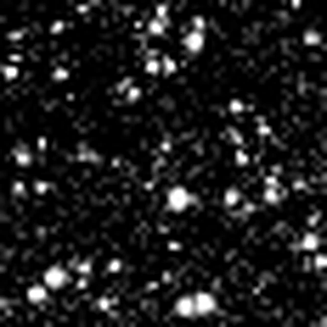
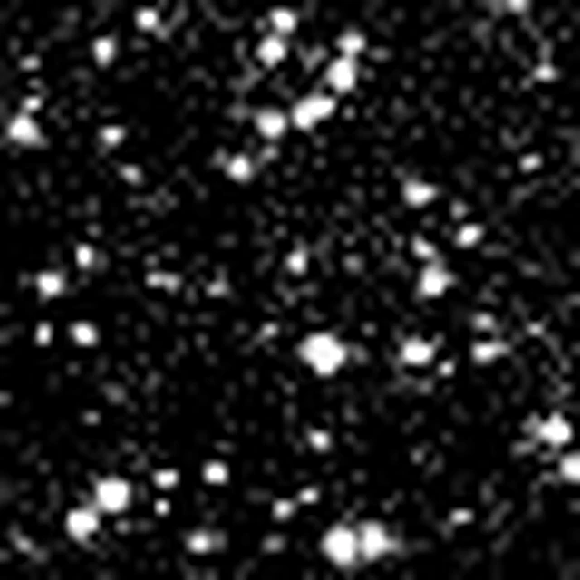
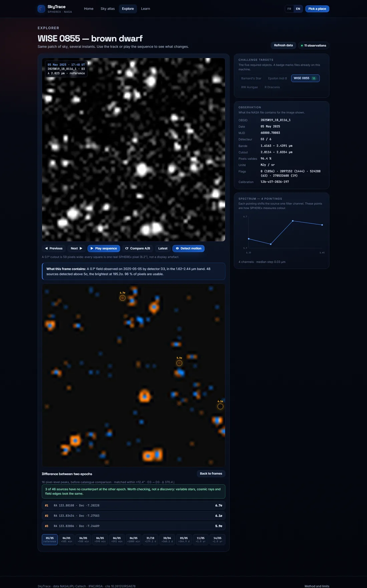

# SkyTrace

Voir le ciel bouger — un outil public pour comparer des images de la mission
**SPHEREx** de la NASA à des dates différentes.

| 2025-05-05 | 2025-05-06 |
|---|---|
|  |  |

Champ de 0,1° autour de la naine brune WISE 0855, détecteurs D3 puis D2,
données SPHEREx Data Release 1 (`l2b-v27`).

NASA International Space Apps Challenge 2026 · challenge *Planet X and SPHEREx* · 14–15 novembre 2026.

| Fichier | Contenu |
|---|---|
| `KIT.md` | **À lire en premier pour construire.** Ce qu'il faut soumettre, prérequis, actifs à produire, bill of materials du code, rôles, chronologie, checklist finale |
| `PRODUCT-BLUEPRINT.md` | Verdict sur l'architecture d'équipe, correction des données (DR1), produit, IA, parcours, API, pipeline scientifique, feuille de route, checklist MVP |
| `ARCHITECTURE.md` | Audit des données mesuré : volumes, latences, anatomie d'un FITS, 4 axes de temps, moteur de mobiles |
| `sky-trace-architecture.html` | Schéma « avant / après » : pourquoi le chemin d'exécution casse et comment le corriger |
| `planetx-spherex-architecture.html` | Architecture système cible en 5 couches |
| `backend/app/science/wcs_wave.py` | ✅ parseur `WCS-WAVE` (table creuse 11×11), testé sur DR1 |
| `backend/app/science/render.py` | ✅ masque par bit, asinh signé, white-light, WebP |
| `scripts/preview_cutout.py` | ✅ cutout → image WebP + géométrie spectrale |
| `scripts/spectrum_from_slews.py` | ✅ spectre depuis la séquence de repointings |
| `scripts/check_dither.py` | ✅ démontre le décalage d'un canal par pose |
| `scripts/probe_mef.py` | ✅ anatomie d'un cutout (HDUs, flags, λ) |

## Lancer l'application en local

Double-clic sur **`lancer.cmd`**, ou :

```bash
uv run --python 3.13 --with fastapi --with uvicorn --with astropy --with numpy --with pillow \
  uvicorn app.main:app --app-dir backend --host 0.0.0.0 --port 8010
```

Puis **http://localhost:8010**. Le port 8000 est souvent occupé par Docker Desktop sur Windows. Trois pages : `/` (accueil), `/explore` (explorateur), `/learn` (méthode et limites).
Interface en français et en anglais, choix mémorisé dans le navigateur.



`/explore?diff=1` ouvre directement la comparaison, pour qu'un lien pointe vers une analyse
et pas seulement vers un champ.

### API

| Route | Rôle |
|---|---|
| `GET /api/health` | état du service et fichiers rejetés |
| `GET /api/stats` | nombre d'observations, couverture, détecteurs |
| `GET /api/epochs` | observations du champ, groupées par axe de temps |
| `GET /api/frames/{obs_id}.webp` | image rendue (cache immuable) |
| `GET /api/metadata/{obs_id}` | en-têtes, flags, calibration |
| `GET /api/spectrum` | spectre construit sur les poses |
| `GET /api/targets` | les cinq cibles du challenge |
| `GET /api/diff?a=&b=` | compare deux époques : carte de différence + sources sans contrepartie |
| `GET /api/track` | objets qui se déplacent entre poses successives : déplacement, durée, vitesse |
| `GET /api/gallery` | toutes les images rendues, groupées par champ, avec leurs chiffres |
| `POST /api/refresh` | intègre les nouveaux fichiers déposés dans `data/frames/` |

### Comparer deux époques

`GET /api/diff?a=<obs>&b=<obs>` aligne les deux images sur une grille commune,
soustrait les fonds, puis compare les **catalogues de sources** plutôt que les pixels.
À 6,2″ par pixel une étoile tient dans un seul pixel : soustraire les images marque
chaque source, comparer les catalogues ne garde que ce qui n'a vraiment pas de
contrepartie. Le verdict est rendu explicitement — `none`, `isolated` ou `many` —
pour qu'aucun résidu ne passe pour une découverte.

Le serveur scanne `data/frames/` à chaque démarrage et rejette toute image dont le cutout
tombe hors du détecteur (`CRPIX ∉ [1, 2040]`) : ces observations existent dans l'archive mais
ne contiennent pas la cible.

### Ajouter une série temporelle

```bash
uv run --python 3.13 --with astropy --with numpy python scripts/fetch_series.py \
  --ra 133.7951 --dec -7.2451 --size 0.1 --max 16
```

Le script interroge SIA2, retient une pose par date et écrit les cutouts dans `data/frames/`.
Un `POST /api/refresh` (ou le bouton « Actualiser les données ») les rend visibles sans redémarrage.

## Docker

```bash
docker compose up --build
```

L'image ne contient pas les FITS : `data/` et `cache/` sont montés en volume.
Pour un hébergement public, le même conteneur tourne sur Render, Fly.io ou un VPS —
il suffit d'exposer le port 8000.

## Hébergement gratuit

`docs/DEPLOY.md` détaille la mise en ligne sur **Render** (plan Free, Docker, sans
carte bancaire) en trois clics via `render.yaml`, ainsi que les limites de
Cloudflare : Workers ne fournit que 10 ms de CPU par requête et ne peut pas
exécuter `astropy`, Cloudflare Containers exige le plan payant à 5 $/mois, seule
Cloudflare Pages reste gratuite — pour un site statique, pas pour ce serveur.

## Commandes

```bash
# toutes les commandes passent par uv, sans environnement à créer
uv run --python 3.13 --with astropy --with numpy --with pillow \
  python scripts/preview_cutout.py data/dr1_w0855.fits out

uv run --python 3.13 --with astropy --with numpy \
  python scripts/spectrum_from_slews.py data/dr1_w0855*.fits --ra 133.7951 --dec -7.2451

# un Makefile existe pour Linux/macOS/CI (make preview, make spectrum, make dither)
```

## État des données au 13/11/2026 (vérifié par TAP)

| Collection | Images | MJD |
|---|---|---|
| `spherex_dr1` | 945 725 | 60789,8 → 61174,5 |
| `spherex_dr1_deep` | 233 681 | 60789,8 → 61174,5 |
| `spherex_qr3` | 362 124 | 61174,5 → 61318,0 |
| `spherex_qr3_deep` | 86 700 | 61174,5 → 61318,0 |

`spherex_qr2` **n'existe plus** dans `obscore` (remplacé par DR1 le 12/11/2026).
DR1 et QR3 sont **complémentaires dans le temps** : un outil qui n'utilise que QR3 n'affiche qu'une seule époque sur la majorité du ciel.

## Reproduire les mesures

```bash
curl -sG https://irsa.ipac.caltech.edu/TAP/sync \
  --data-urlencode REQUEST=doQuery --data-urlencode LANG=ADQL --data-urlencode FORMAT=csv \
  --data-urlencode "QUERY=SELECT obs_collection, COUNT(*) n FROM spherex.obscore
    WHERE 1=CONTAINS(POINT('ICRS',133.7951,-7.2451), s_region) GROUP BY obs_collection"

curl -o c.fits "https://irsa.ipac.caltech.edu/ibe/data/spherex/dr1/level2/2025W19_1B/l2b-v27-2026-197/2/level2_2025W19_1B_0181_1D2_spx_l2b-v27-2026-197.fits?center=133.7951,-7.2451&size=0.05"

uv run --with astropy --with numpy --with pillow python scripts/probe_mef.py c.fits
```

## Données

NASA/JPL-Caltech · IPAC/IRSA — [conditions d'utilisation](https://irsa.ipac.caltech.edu/data_use_terms.html).
